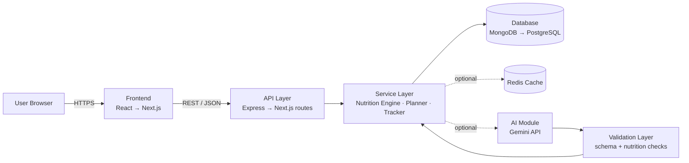
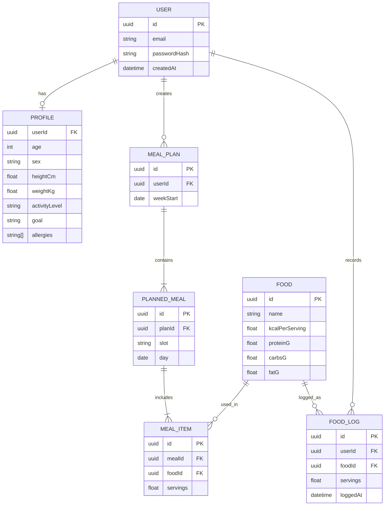
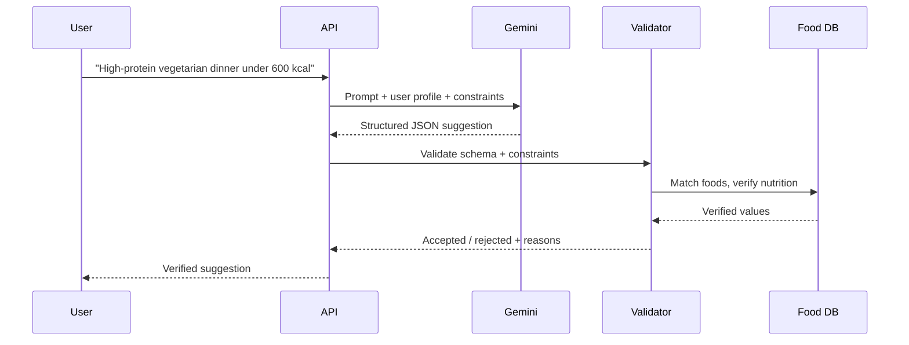

<div align="center">


<a href="https://git.io/typing-svg">
  
</a>

<br/>


**[Live Demo](#)** · **[API Docs](#api-overview)** · **[Architecture](#architecture)** · **[Roadmap](#roadmap)**

</div>

---

> **Project status:** this README describes the planned design of NutriPlan. Items in the [Roadmap](#roadmap) are ticked only after they are built and verified. Screenshots, the demo link and any metrics are added when they exist, never before.

## Table of Contents

- [What is NutriPlan?](#what-is-nutriplan)
- [Why this project exists](#why-this-project-exists)
- [Features](#features)
- [How the nutrition engine works](#how-the-nutrition-engine-works)
- [Architecture](#architecture)
- [Tech stack](#tech-stack)
- [Data model](#data-model)
- [API overview](#api-overview)
- [AI integration design](#ai-integration-design)
- [Security](#security)
- [Getting started](#getting-started)
- [Testing](#testing)
- [Project structure](#project-structure)
- [Roadmap](#roadmap)
- [Technical challenges](#technical-challenges)
- [Known limitations](#known-limitations)
- [Contributing](#contributing)

---

## What is NutriPlan?

NutriPlan is a full-stack web application where users set up a nutrition profile, get **personalized daily calorie and macro targets**, build **weekly meal plans**, log what they eat, and see how they are doing against their goals. When a food doesn't fit, NutriPlan proposes **substitutions** that keep the day's numbers on track.

The core of the project is the **nutrition and planning logic**, not a dashboard of static data. The app is fully usable without any AI; the AI features are an optional layer on top.

## Why this project exists

Most meal-planning apps either show generic advice or lock useful features behind paywalls. NutriPlan is built to demonstrate how to:

- turn a user's body metrics and goals into **explainable** numeric targets,
- model food, meals and plans in a **relational schema**,
- build a **secure, validated REST API**,
- add **AI where it solves a real problem**, with its output checked before it reaches the user.

## Features

| Area | What you get |
|---|---|
| **Profile and goals** | Age, sex, height, weight, activity level, goal (lose / maintain / gain), dietary preferences and allergies |
| **Personalized targets** | Daily calories, protein, carbs and fat computed from the profile |
| **Food search** | Search foods and view per-serving nutrition details |
| **Meal planner** | Weekly planner with breakfast, lunch, dinner and snacks |
| **Daily tracking** | Log meals and see progress against targets in real time |
| **Smart substitutions** | Swap a food for one with similar macros that respects preferences |
| **Analytics** | Weekly and monthly trends in calories and macros |
| **AI assistant** *(stage 2)* | Natural-language planning and context-aware suggestions |
| **Auth** | Registration, login, protected routes, profile management |

## How the nutrition engine works

The engine is plain, testable code, independent of the UI and the AI.

**1. Basal metabolic rate (Mifflin–St Jeor)**

```
Male:    BMR = 10·weight(kg) + 6.25·height(cm) − 5·age + 5
Female:  BMR = 10·weight(kg) + 6.25·height(cm) − 5·age − 161
```

**2. Total daily energy expenditure**

```
TDEE = BMR × activity_factor      (sedentary 1.2 … very active 1.9)
```

**3. Goal adjustment** — the calorie target is TDEE adjusted for the chosen goal (deficit, maintenance or surplus).

**4. Macro split** — calories are divided into protein, carbohydrate and fat targets (4, 4 and 9 kcal per gram respectively).

**5. Daily tracking** — every logged item contributes `quantity × per-serving nutrition`; the dashboard aggregates these against the targets.

**6. Substitutions** — candidate foods are scored by macro distance from the original, filtered by allergies and preferences, and ranked.

> The formulas are the standard published ones; the exact activity factors, goal adjustments and macro ratios are configurable and documented in `docs/nutrition-engine.md`. This is a planning tool, **not medical advice**.

## Architecture



**Design principles**

- **Business logic is separated** from routes and controllers, so it is unit-testable.
- **The AI layer is optional**: if it fails or is disabled, every core feature still works.
- **Two-stage build**: ship a solid MERN MVP first, then migrate to a modern stack.

### Evolution of the stack

| Layer | Stage 1 — MERN MVP | Stage 2 — Modern full-stack |
|---|---|---|
| Frontend | React, HTML, CSS, JavaScript | Next.js, TypeScript, Tailwind CSS |
| Backend | Node.js, Express | Next.js server functionality / Node service |
| Database | MongoDB | PostgreSQL + Prisma (or Drizzle) |
| Auth | JWT or secure sessions, hashed passwords | Improved auth and authorization |
| Extras | — | Redis (only where useful), Docker, Gemini API |

## Tech stack

**Frontend:** React · Next.js · TypeScript · Tailwind CSS
**Backend:** Node.js · Express.js · REST APIs
**Database:** MongoDB → PostgreSQL · Prisma / Drizzle
**AI:** Gemini API
**Tooling:** Git · GitHub · Docker · deployment platform · API and unit testing

## Data model

Planned relational model for stage 2 (PostgreSQL):



## API overview

> Planned endpoints. The final reference will live in `docs/api.md` (and OpenAPI/Swagger if added).

| Method | Endpoint | Description |
|---|---|---|
| `POST` | `/api/auth/register` | Create an account |
| `POST` | `/api/auth/login` | Log in |
| `GET` | `/api/profile` | Get profile and computed targets |
| `PUT` | `/api/profile` | Update profile and goals |
| `GET` | `/api/foods?query=` | Search foods |
| `GET` | `/api/foods/:id/substitutes` | Suggested substitutions |
| `GET` | `/api/plans?week=` | Get a weekly meal plan |
| `POST` | `/api/plans` | Create or update a plan |
| `POST` | `/api/logs` | Log a food entry |
| `GET` | `/api/logs/summary?date=` | Daily totals vs. targets |
| `GET` | `/api/analytics/trends` | Weekly / monthly trends |
| `POST` | `/api/ai/suggest` | AI-assisted meal suggestion *(stage 2)* |

## AI integration design

AI is only valuable here if it is **trustworthy**. The rules:

1. **The app never depends on AI.** All core flows work without it.
2. **Structured output only.** The model is prompted to return JSON, which is parsed against a strict schema.
3. **Nutrition values are verified.** AI-suggested foods are matched against the app's food database; unknown items or implausible numbers are rejected or flagged.
4. **Constraints are enforced in code**, not just in the prompt (allergies, calorie and macro bounds).
5. **Everything is tracked**: prompts, responses and validation results are logged for debugging and evaluation.
6. **Rate limited** per user to control cost and abuse.



## Security

- Passwords hashed with a strong algorithm (bcrypt or argon2); never stored in plain text
- JWT or secure session cookies with sensible expiry
- Input validation on every endpoint (schema validation)
- Authorization checks so users can only access their own data
- API rate limiting
- Secrets in environment variables, never committed
- CORS and security headers configured

## Getting started

> Setup commands will be finalised as the project is built. This is the intended flow.

**Prerequisites:** Node.js 20+, a database (MongoDB for stage 1, PostgreSQL for stage 2), Git. Docker is optional.

```bash
# 1. Clone
git clone https://github.com/<your-username>/nutriplan.git
cd nutriplan

# 2. Install dependencies
npm install

# 3. Configure environment
cp .env.example .env
# fill in the values below

# 4. Run in development
npm run dev
```

**Environment variables**

| Variable | Purpose |
|---|---|
| `DATABASE_URL` | Database connection string |
| `JWT_SECRET` | Secret for signing tokens |
| `GEMINI_API_KEY` | Enables AI features (optional) |
| `REDIS_URL` | Enables caching (optional) |

**With Docker**

```bash
docker compose up --build
```

## Testing

- **Unit tests** for the nutrition engine (BMR, TDEE, macro maths, substitution scoring)
- **API tests** for every endpoint, including error cases
- **Authentication and authorization tests**
- **Validation tests** for malformed input and AI output

```bash
npm test
```

## Project structure

```
nutriplan/
├── client/                # Frontend
│   ├── components/
│   ├── pages/ (or app/)
│   └── lib/
├── server/                # Backend
│   ├── routes/
│   ├── controllers/
│   ├── services/          # nutrition engine, planner, tracker
│   ├── models/ (or prisma/)
│   ├── middleware/        # auth, validation, rate limiting
│   └── ai/                # prompts, client, output validation
├── tests/
├── docs/                  # API reference, engine notes, diagrams
├── docker-compose.yml
└── README.md
```

## Roadmap

**Stage 1 — MERN MVP**
- [ ] Requirements, user flows, wireframes, initial schema
- [ ] Landing, auth, dashboard, planner and food search UI
- [ ] Express REST API with MongoDB
- [ ] Authentication, profile and preferences
- [ ] Calorie and macro calculations
- [ ] Daily tracking, meal planning, substitutions
- [ ] API and auth tests, deployment, README and screenshots

**Stage 2 — Modern full-stack and AI**
- [ ] Migrate to TypeScript and Next.js
- [ ] Move to PostgreSQL with Prisma or Drizzle
- [ ] Improve authentication and authorization
- [ ] Caching with Redis where it helps
- [ ] AI meal suggestions and natural-language planning
- [ ] AI output validation and tracking

## Technical challenges

*This section will be filled in with real problems and solutions as they are encountered, for example:*

- Designing a schema that supports foods, servings, plans and logs without duplication
- Keeping nutrition calculations accurate and unit-tested
- Validating AI-generated nutrition data against a trusted source
- Migrating from MongoDB to PostgreSQL without losing data integrity

## Known limitations

- Nutrition targets are estimates from standard formulas, not medical advice
- Food data quality depends on the data source used
- AI suggestions are validated but can still be imperfect

## Contributing

Issues and suggestions are welcome. Please open an issue before large changes.

---

<div align="center">

**Built to be understood, explained and defended, not just demoed.**


</div>
