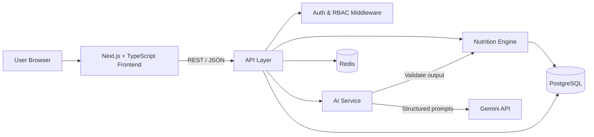
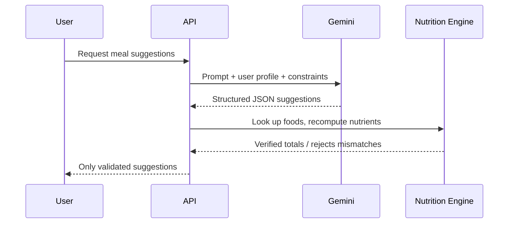
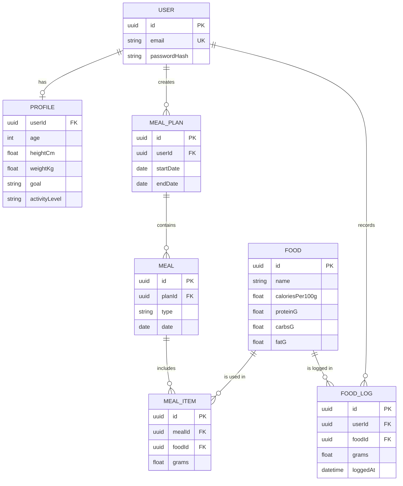

<div align="center">

# 🥗 NutriPlan

### Plan smarter. Eat better. Track what matters.

A full-stack nutrition and meal-planning platform with a verified nutrition engine and AI-assisted meal suggestions.


[Live Demo](#) · [Demo Video](#) · [Report a Bug](../../issues) · [Request a Feature](../../issues)

</div>

---

## 📑 Table of Contents

- [About](#-about)
- [Features](#-features)
- [Screenshots](#-screenshots)
- [Architecture](#-architecture)
- [Tech Stack](#-tech-stack)
- [The Nutrition Engine](#-the-nutrition-engine)
- [AI Integration](#-ai-integration)
- [Data Model](#-data-model)
- [API Overview](#-api-overview)
- [Getting Started](#-getting-started)
- [Testing](#-testing)
- [Security](#-security)
- [Roadmap](#-roadmap)
- [Technical Challenges & Trade-offs](#-technical-challenges--trade-offs)
- [Project Structure](#-project-structure)
- [Contributing](#-contributing)
- [License](#-license)
- [Author](#-author)

---

## 🎯 About

Most nutrition apps either track food or suggest meals, and few do both reliably. **NutriPlan** lets users set their goals and preferences, build weekly meal plans, track daily intake, and get intelligent suggestions. Every suggestion is checked against real nutrition data before it reaches the user.

**Problem it solves**

- Hitting calorie and macro targets takes manual arithmetic.
- Meal plans fall apart when one food needs to be swapped.
- AI-generated nutrition advice can't be trusted unless it is validated.

**What this project demonstrates:** building, integrating, testing and deploying a complete software product independently, then extending it with AI.

> 📌 **Project approach:** NutriPlan is built in two stages. **Stage 1** is a MERN MVP (React, Node, Express, MongoDB). **Stage 2** upgrades it to a modern stack (Next.js, TypeScript, PostgreSQL, Redis, Docker, CI/CD) and adds AI features.

---

## ✨ Features

### Core (MVP)
- 🔐 **Authentication and protected routes** with JWT-based sessions
- 👤 **User profiles** with goals, dietary preferences and allergies
- 🍎 **Food search and detail pages** with full nutrient breakdowns
- 📅 **Meal-plan builder** with full CRUD
- 🔁 **Meal substitutions** that recalculate totals instantly
- 📊 **Daily and weekly nutrition tracking** (calories, protein, carbs, fats)
- 📈 **Dashboard and analytics** with macro charts, weekly trends and meal history
- ✅ **Plan validation** against user-defined targets

### Modern upgrade
- ⚡ Next.js and TypeScript with end-to-end type safety
- 🐘 PostgreSQL with Prisma or Drizzle, plus constraints and migrations
- 🚀 Redis caching where it is justified
- 🐳 Docker and a CI/CD pipeline

### AI features
- 🤖 Personalised meal suggestions
- 🔄 Smart food-substitution recommendations
- 💬 Plain-language explanations of nutritional trade-offs
- 📝 Meal-plan draft generation
- 🛡️ **Validation of every AI suggestion against real nutrition data**

---

## 🖼️ Screenshots

> Screenshots will be added as the UI is built.

| Dashboard | Meal Planner | Food Details |
|:---:|:---:|:---:|
| _coming soon_ | _coming soon_ | _coming soon_ |

---

## 🏗️ Architecture



**Design principles**

- **Separation of concerns.** The nutrition engine is a pure, framework-independent module that is easy to test.
- **Never trust AI output.** Suggestions pass through the nutrition engine before they are shown.
- **Cache only what is justified.** Redis is introduced for measured needs, not by default.

---

## 🧰 Tech Stack

| Stage | Layer | Technologies |
|---|---|---|
| **MVP** | Frontend | HTML, CSS, JavaScript, React |
| | Backend | Node.js, Express.js |
| | Database | MongoDB |
| | API | REST |
| **Modern** | Frontend | Next.js, TypeScript, Tailwind CSS |
| | Data | PostgreSQL, Prisma or Drizzle |
| | Caching | Redis |
| | Charts | Recharts |
| **AI** | LLM | Gemini API (structured outputs) |
| **DevOps** | Deployment | Docker, cloud hosting, CI/CD |
| **Quality** | Testing | Jest / Vitest, API and integration tests |

---

## 🧮 The Nutrition Engine

The engine is the heart of NutriPlan. It is isolated from the web layer and covered by unit tests.

**Energy needs**

- **BMR** (Mifflin-St Jeor):
  - Men: `10 × weight(kg) + 6.25 × height(cm) − 5 × age + 5`
  - Women: `10 × weight(kg) + 6.25 × height(cm) − 5 × age − 161`
- **TDEE** = BMR × activity multiplier
- **Goal calories** = TDEE adjusted for the user's goal (deficit, maintenance or surplus)

**Macro energy values**

| Macronutrient | kcal per gram |
|---|---|
| Protein | 4 |
| Carbohydrates | 4 |
| Fat | 9 |

**Responsibilities**

- Per-food nutrient scaling by portion size
- Meal, daily and weekly totals
- Substitution impact calculation
- Validation of meal plans against targets, with a configurable tolerance

> ⚠️ NutriPlan is an educational and planning tool, not medical advice. It does not replace a qualified dietitian or physician.

---

## 🤖 AI Integration

AI is a **suggestion layer**, never the source of truth.



- **Structured outputs:** responses are parsed against a schema, and malformed responses are rejected.
- **Grounding:** nutrient values come from the database, not from the model.
- **Allergy and preference filters** are applied after generation.
- **Graceful degradation:** if the AI service fails, the rest of the app keeps working.

---

## 🗄️ Data Model



---

## 🔌 API Overview

| Method | Endpoint | Description | Auth |
|---|---|---|:---:|
| `POST` | `/api/auth/register` | Create an account | ❌ |
| `POST` | `/api/auth/login` | Log in and receive a session | ❌ |
| `GET` | `/api/profile` | Get the current user's profile | ✅ |
| `PUT` | `/api/profile` | Update goals and preferences | ✅ |
| `GET` | `/api/foods?query=` | Search foods | ✅ |
| `GET` | `/api/foods/:id` | Food details | ✅ |
| `GET` | `/api/meal-plans` | List meal plans | ✅ |
| `POST` | `/api/meal-plans` | Create a meal plan | ✅ |
| `PUT` | `/api/meal-plans/:id` | Update a meal plan | ✅ |
| `DELETE` | `/api/meal-plans/:id` | Delete a meal plan | ✅ |
| `POST` | `/api/meal-plans/:id/validate` | Validate against targets | ✅ |
| `POST` | `/api/logs` | Log consumed food | ✅ |
| `GET` | `/api/analytics/weekly` | Weekly nutrition summary | ✅ |
| `POST` | `/api/ai/suggestions` | Get validated AI suggestions | ✅ |

> The final API contract will be documented with OpenAPI / Swagger.

---

## 🚀 Getting Started

### Prerequisites

- Node.js 20+
- npm or pnpm
- MongoDB (MVP) or PostgreSQL (modern stack)
- Docker (optional)
- A Gemini API key (for AI features)

### Installation

```bash
# 1. Clone the repository
git clone https://github.com/<your-username>/nutriplan.git
cd nutriplan

# 2. Install dependencies
npm install

# 3. Configure environment variables
cp .env.example .env

# 4. Run in development
npm run dev
```

### Environment variables

| Variable | Description |
|---|---|
| `DATABASE_URL` | Database connection string |
| `JWT_SECRET` | Secret used to sign tokens |
| `REDIS_URL` | Redis connection string (modern stack) |
| `GEMINI_API_KEY` | API key for AI features |
| `NODE_ENV` | `development` or `production` |

> 🔒 Never commit `.env`. Use `.env.example` with placeholder values only.

### Run with Docker

```bash
docker compose up --build
```

> ℹ️ Commands above are the intended setup. Adjust them to match the final scripts in `package.json`.

---

## 🧪 Testing

```bash
npm test                # unit tests
npm run test:integration # API and integration tests
npm run test:coverage   # coverage report
```

**Testing priorities**

1. Nutrition engine: calculations, rounding and edge cases
2. Authentication and authorisation flows
3. Meal-plan CRUD and validation
4. AI response validation and failure handling

---

## 🔐 Security

- Passwords hashed with **bcrypt** or **argon2**, never stored in plain text
- JWT secrets and API keys loaded from environment variables
- Input validation on every endpoint, with a schema validator such as Zod
- Protected routes and ownership checks, so users can only access their own data
- Rate limiting on authentication and AI endpoints
- Secure HTTP headers (Helmet), and CORS restricted to known origins
- Parameterised queries and ORM usage to prevent injection

---

## 🗺️ Roadmap

- [ ] **Phase 1:** Product planning, wireframes, data modelling
- [ ] **Phase 2:** Frontend (landing page, auth screens, dashboard, food search)
- [ ] **Phase 3:** Backend (REST APIs, authentication, CRUD)
- [ ] **Phase 4:** Nutrition engine (calories, macros, substitutions, validation)
- [ ] **Phase 5:** Dashboard and analytics (charts, trends, history)
- [ ] **Phase 6:** Testing, security hardening, first deployment
- [ ] **Phase 7:** Modern upgrade (Next.js, TypeScript, PostgreSQL, Redis, Docker, CI/CD)
- [ ] **Phase 8:** AI integration (suggestions, substitutions, explanations, drafts)

---

## 🧠 Technical Challenges & Trade-offs

> This section will be filled with real decisions as the project progresses. Prompts to answer honestly:

| Topic | Decision to document |
|---|---|
| MongoDB → PostgreSQL | Why migrate, and what changed in the data model? |
| Caching | What was cached, why, and how is it invalidated? |
| Nutrition accuracy | Which data source, and how are rounding and units handled? |
| AI reliability | How are hallucinated or invalid suggestions detected? |
| Auth strategy | Why this session approach? |

---

## 📁 Project Structure

```text
nutriplan/
├── apps/
│   ├── web/                # Frontend (React → Next.js)
│   └── api/                # Backend (Express)
├── packages/
│   └── nutrition-engine/   # Pure, tested calculation logic
├── prisma/                 # Schema and migrations (modern stack)
├── docs/                   # Architecture diagrams, ADRs, API docs
├── docker-compose.yml
├── .github/workflows/      # CI/CD
└── README.md
```

> This is a suggested layout and can change as the project evolves.

---

## 🤝 Contributing

Contributions, issues and suggestions are welcome.

1. Fork the project
2. Create a feature branch: `git checkout -b feature/amazing-feature`
3. Commit with a meaningful message: `git commit -m "feat: add amazing feature"`
4. Push the branch: `git push origin feature/amazing-feature`
5. Open a pull request

---

## 📄 License

Distributed under the MIT License. See `LICENSE` for details.

---

## 👤 Author

**Your Name**

- GitHub: [@your-username](https://github.com/your-username)
- LinkedIn: [your-profile](https://linkedin.com/in/your-profile)

<div align="center">

⭐ If you find this project useful, consider giving it a star.

</div>
